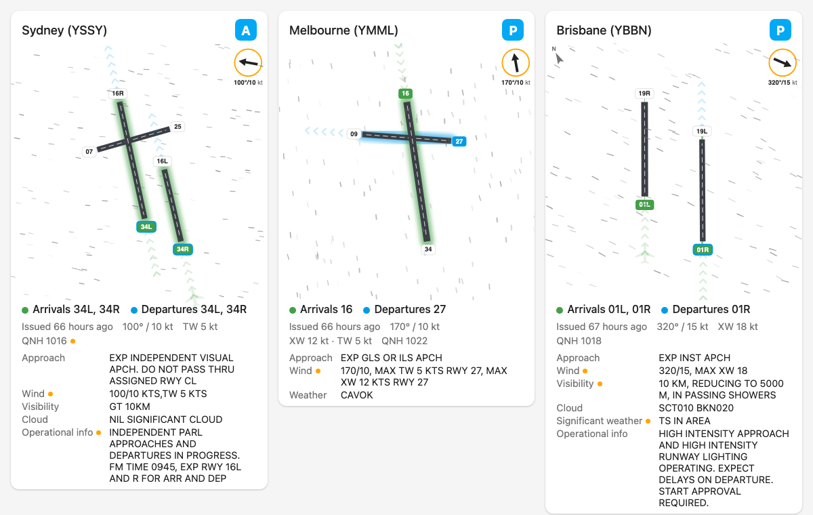
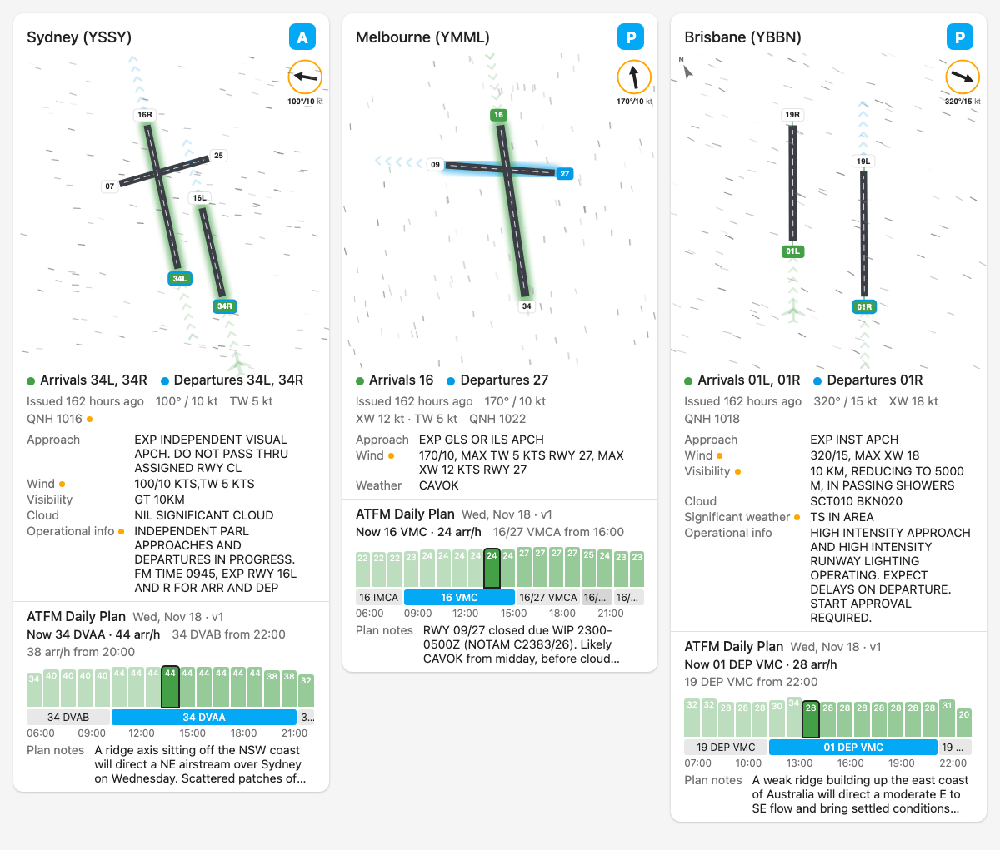

# ✈️ Aussie ATIS Lovelace Card

A Home Assistant dashboard card that draws an Australian airport's runways and animates the ones in use, using live ATIS from the [Australian ATIS integration](https://github.com/BigByte76/home-assistant-aussie-atis).

<picture>
  <source media="(prefers-color-scheme: dark)" srcset="images/preview-dark.png">
  
</picture>

## Features

- **The airport's real runway layout**, drawn to scale, with runway numbers at each end.
- **Arrival runways** glow green, with chevrons and an aircraft flying the approach and landing.
- **Departure runways** glow blue, with chevrons and an aircraft taking off and climbing out.
- **Runways used for both** alternate between green and blue.
- **Wind** drifts across the map, and a wind arrow shows the direction and speed, including gusts.
- **ATIS details** below the map: information letter, issue time, wind components, QNH, approach, weather and more. Fields that changed in the latest broadcast are marked with an orange dot, and the runways pulse when they've changed.
- **ATFM Daily Plan** (optional) for Sydney, Melbourne, Brisbane and Perth: the planned runway mode and arrival rate for each hour, with the current hour marked, the next planned changes, any ground delay program, and the plan's weather notes.
- **Two orientations:** north up, or rotated so the main arrival runway points up.
- **Light and dark themes** use your Home Assistant theme colours.
- **Motion is easy on your device and your eyes.** Animations pause when the card is off-screen or the tab is hidden, and stop completely if your device is set to reduce motion.
- **A visual editor**, so you don't need to write YAML.

<!-- ha-marketplace:exclude-start -->
## 🧰 Installation

You need the [Australian ATIS integration](https://github.com/BigByte76/home-assistant-aussie-atis) set up first, with the airports you want to show.

### Marketplace (Home Assistant 2026.11 and newer)

[](https://my.home-assistant.io/redirect/marketplace_repository/?owner=BigByte76&repository=aussie-atis-lovelace-card&category=plugin)

1. Select the badge above. The repository isn't in the default list, so the Marketplace offers to add it as a custom repository.
2. Select **Install**, then reload your browser.

### HACS (Home Assistant before 2026.11)

[](https://my.home-assistant.io/redirect/hacs_repository/?owner=BigByte76&repository=aussie-atis-lovelace-card&category=plugin)

1. Select the badge above, or in HACS open **⋮ → Custom repositories** and add `https://github.com/BigByte76/aussie-atis-lovelace-card` with the type **Dashboard**.
2. Install **Aussie ATIS Lovelace Card**, then reload your browser.

### Manual

1. Download `aussie-atis-card.js` from the [latest release](https://github.com/BigByte76/aussie-atis-lovelace-card/releases/latest).
2. Copy it to `config/www/aussie-atis-card.js`.
3. Go to **Settings → Dashboards → ⋮ → Resources**, and add `/local/aussie-atis-card.js` as a **JavaScript module**.
4. Reload your browser.
<!-- ha-marketplace:exclude-end -->

## ⚙️ Adding the card

Open your dashboard and choose **Edit dashboard → Add card**, then search for **Aussie ATIS**. Pick the airport in the editor.

Or use YAML, with one card per airport:

```yaml
type: custom:aussie-atis-card
airport: ymml
```

| Option | Default | Description |
| --- | --- | --- |
| `airport` | *required* | ICAO code of an airport set up in the Australian ATIS integration, e.g. `yssy`. |
| `title` | Airport name and code | Card title. |
| `orientation` | `north` | `north` for north up, or `arrival` to rotate the map so the main arrival runway points up. A small arrow shows north when the map is rotated. |
| `show_planes` | `true` | Show the aircraft flying the approaches and departures. The chevrons are always shown. |
| `show_wind` | `true` | Show the wind particles and wind arrow. |
| `show_info` | `true` | Show the ATIS details below the map. |
| `show_atfm` | `false` | Show the ATFM Daily Plan below the map. Only for YSSY, YMML, YBBN and YPPH, and needs **Include ATFM Daily Plan** turned on in the integration (version 2.2 or newer). In the editor, tick **ATFM Daily Plan**. |

### Colours

You can change the colours from a theme or with [card-mod](https://github.com/thomasloven/lovelace-card-mod):

| Variable | Default |
| --- | --- |
| `--aac-arrival-color` | your theme's `--success-color` |
| `--aac-departure-color` | your theme's `--info-color` |
| `--aac-runway-color` | `#3b3f45` |

## 🗓️ ATFM Daily Plan

For Sydney, Melbourne, Brisbane and Perth, the card can also show the Airservices Australia [ATFM Daily Plan](https://www.airservicesaustralia.com/noc/), the day's planned runway mode and arrival rate. Tick **ATFM Daily Plan** in the card editor, or add `show_atfm: true`:

```yaml
type: custom:aussie-atis-card
airport: yssy
show_atfm: true
```

<picture>
  <source media="(prefers-color-scheme: dark)" srcset="images/atfm-dark.png">
  
</picture>

Below the ATIS details, the card shows:

- **Now:** the planned runway mode and arrival rate for the current hour, followed by the next planned changes, e.g. `34 DVAB from 22:00`.
- **Hour by hour:** a bar for each hour's planned arrival rate, with the runway mode underneath. The current hour is outlined, and past hours are faded. Hover over a bar for its details.
- **Ground delay program:** when one is planned, its times, the number of flights affected and the average delay, highlighted in orange.
- **Plan notes:** the plan's weather notes for the current hour. Select them to read them in full.

Times are shown in the time zone you've chosen in your Home Assistant profile. The current hour moves on by itself, on the hour.

You need the Australian ATIS integration **2.2 or newer**, with **Include ATFM Daily Plan** turned on: open the integration and choose **Configure**. The plan is published each evening for the next day and is a snapshot. For current flow management information, use Airservices' METCDM.

## 🗺 Where the runway layout comes from

Australian ATIS **2.1 and newer** provides each airport's runway layout from aussieadsb.com, as the `runways` attribute of `sensor.<icao>_atis`.

With older versions of the integration, the card uses a layout built in from [OurAirports](https://ourairports.com/data/) (public domain) for all 35 airports the integration supports.

If the ATIS names a runway that isn't on the map, the card lists it under the map instead.

## ❓ Troubleshooting

- **"No data for …":** the card couldn't find `sensor.<icao>_atis`. Check that the airport is selected in the Australian ATIS integration, and that `airport` is its ICAO code.
- **The runways are grey and say "No ATIS":** the airport isn't broadcasting an ATIS right now, usually because the tower is closed.
- **"No ATFM Daily Plan for …":** the plan only covers YSSY, YMML, YBBN and YPPH. For those, open the Australian ATIS integration, choose **Configure** and turn on **Include ATFM Daily Plan**.
- **Nothing moves:** your device may be set to reduce motion. The card then shows static arrows and aircraft instead.

<!-- ha-marketplace:exclude-start -->
## 🧪 Development

```bash
npm install
npm test          # unit tests (Vitest)
npm run typecheck
npm run build     # dist/aussie-atis-card.js (commit it: HACS reads it from the default branch)
npm run layouts   # rebuild the bundled layouts from OurAirports
```

To see the card without Home Assistant, build it, serve the repository root (for example `python3 -m http.server`), and open `/demo/`. Add `?theme=dark` for dark colours. The demo's clock is pinned to the day of the ATFM Daily Plan fixture; add `?now=real` for the real time, and `?only=yssy,ymml` to show only those cards. The demo uses `demo/states.json`, which is built from the integration's test fixtures.

### Releasing

1. Set the same version in `package.json` and `CARD_VERSION` in `src/aussie-atis-card.ts`.
2. Publish a GitHub release tagged `v<version>`, for example `v0.1.0`.
3. The release workflow builds the card and attaches `aussie-atis-card.js` to the release.
<!-- ha-marketplace:exclude-end -->

## ⚠️ Disclaimer

This card is for information and hobby use only. It is **not** an official source and must not be used for flight planning or navigation. Always get official ATIS and weather information from Airservices Australia or the Bureau of Meteorology.
